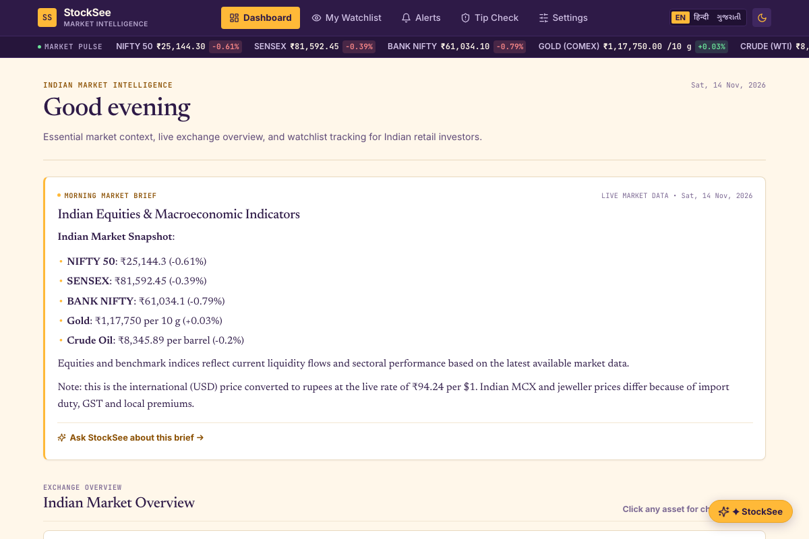
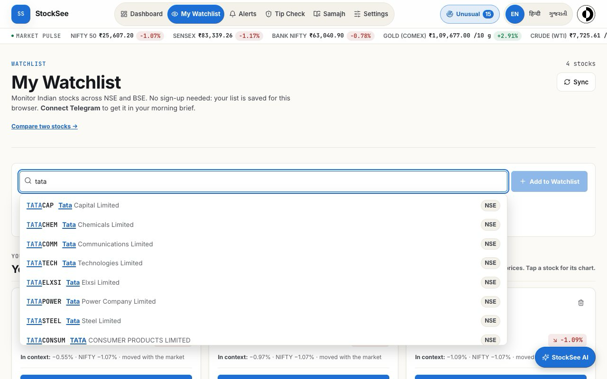
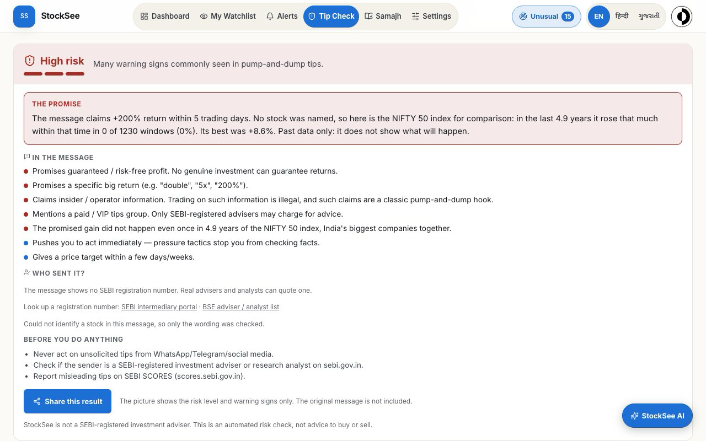
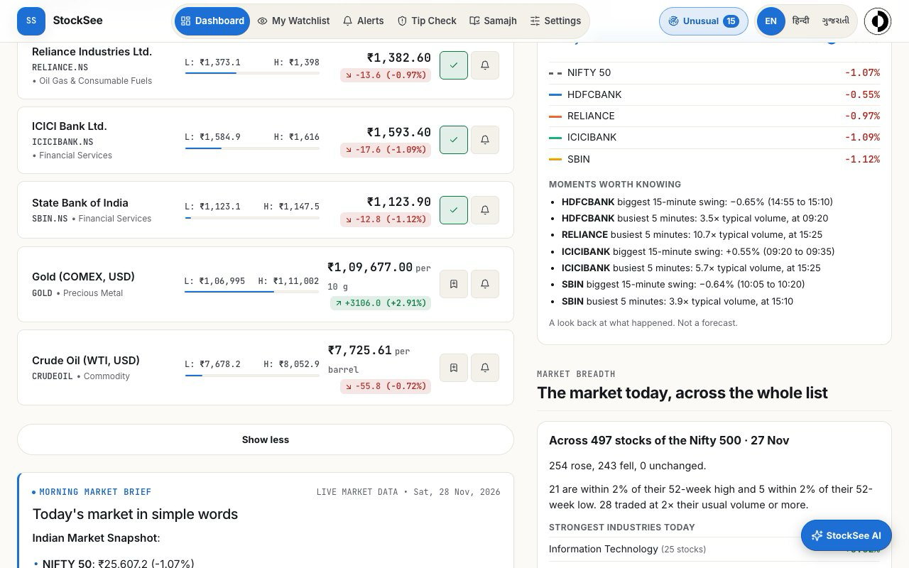
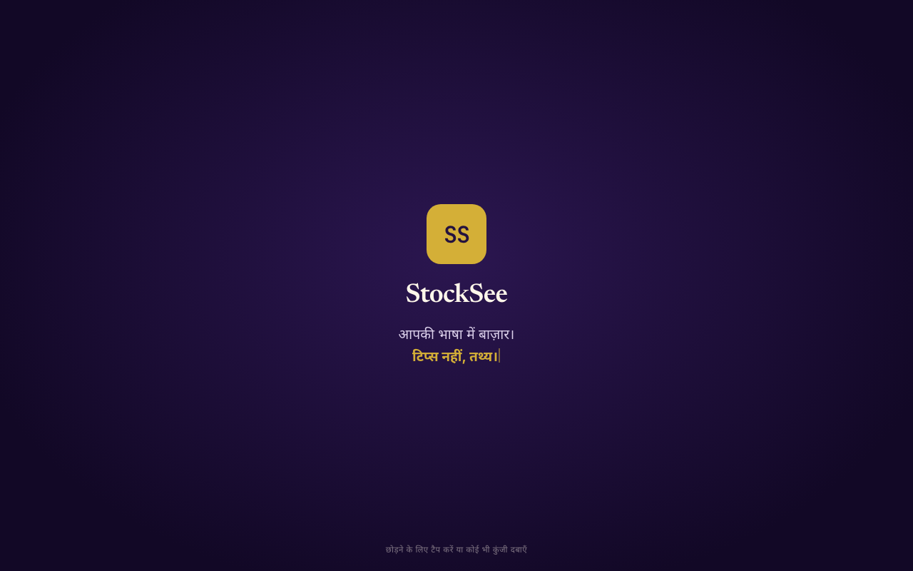
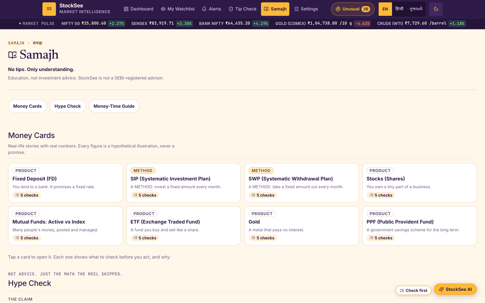
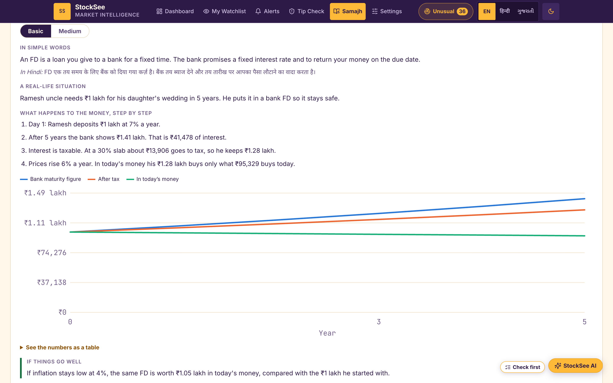
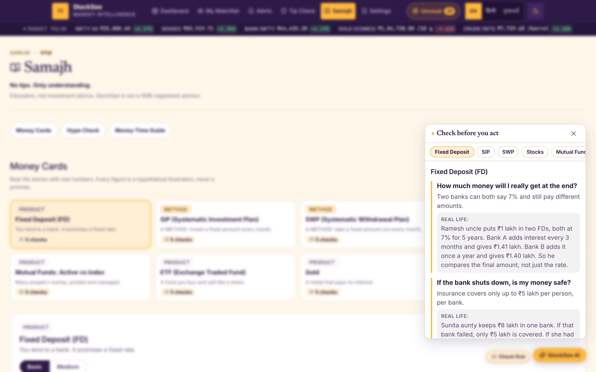
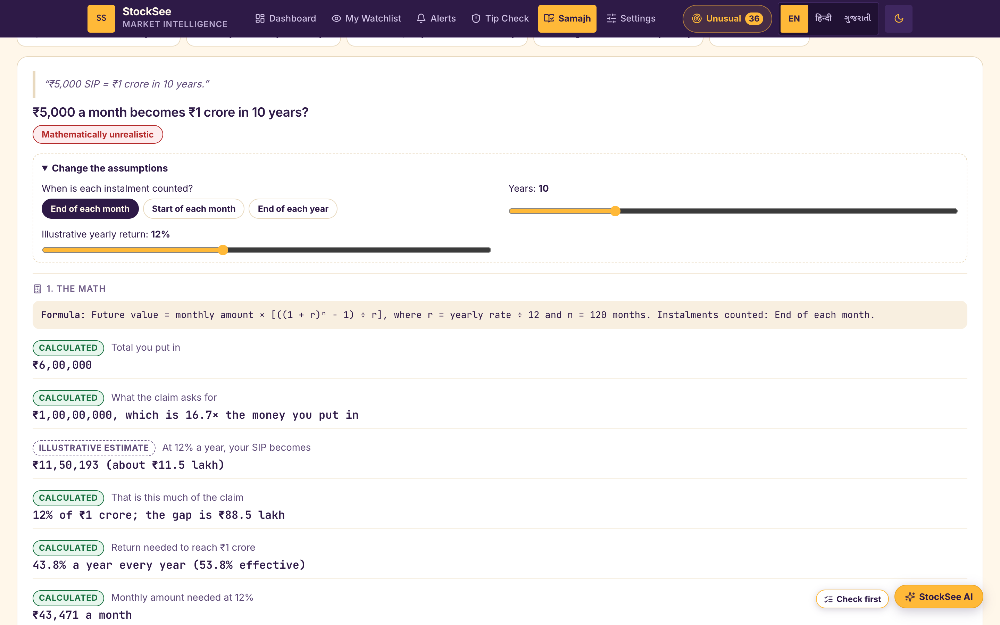

# StockSee — Vernacular Market Intelligence & Watchlist

## Overview

StockSee is a mobile-first financial companion for Indian retail investors that turns market noise around Gold, Crude, Stocks, and relevant Indian market context into simple, personalized, native-language insights.

## Architecture

| Layer | Technology |
|---|---|
| Runtime | Node.js 18.17+ |
| Backend | Express 4, zod validation, central error middleware, express-rate-limit |
| Database | PostgreSQL via Prisma (committed migrations) |
| Frontend | React 18, Vite, React Router, lightweight-charts |
| Telegram | Telegraf |
| AI | Google Gemini, Groq fallback, then verified templates |
| Market data | yahoo-finance2 + Yahoo chart API (development) |
| Scheduling | node-cron (Asia/Kolkata) |
| Caching | In-memory by default, Redis if `REDIS_URL` is set |
| Monitoring | Sentry if `SENTRY_DSN` is set |
| Tests | Jest + Supertest (backend, real test database), Vitest (frontend logic) |

**Planned, not built yet:** a paid market-data feed (Upstox / Angel One) for production.

```
src/
  routes/ controllers/   HTTP layer (zod schemas in controllers/schemas.js)
  services/              market data, AI, Tip Check, symbol search, Telegram, alerts
  analytics/             pure functions shared by alerts, backtests, chart markers, Tip Check
  jobs/                  morning brief, weekly digest, alert evaluation (dependency-injected)
  middleware/            anonymous-visitor cookie, error handling, symbol validation
frontend/src/            pages, components, context providers, services (API clients)
prisma/                  schema + migrations
tests/                   backend tests
docs/screenshots/        images used below
```

## Screenshots

| | |
|---|---|
|  |  |
| Dashboard: live brief; gold and crude converted to rupees | Typeahead search: highlighted matches, keyboard selection |
|  |  |
| Tip Check: warning signs from real market data | Watchlist: gold in ₹ per 10 g (international price, converted) |
|  |  |
| Intro: a scan line clears the noise | Intro: tagline in Hindi |
|  |  |
| Samajh: money education with no tips, only understanding | Money Card (Fixed Deposit): a real-life story, then the numbers step by step |
|  |  |
| "Check first": what to check before acting, and why, with a real-life story | Hype Check: a claim like "₹5,000 SIP = ₹1 crore" tested with an adjustable calculator |

## Setup

1. Install dependencies:

```bash
npm install
cd frontend && npm install && cd ..
```

2. Start PostgreSQL (e.g. Postgres.app) and create two databases: `stocksee` and `stocksee_test`.

3. Copy `.env.example` to `.env` and fill in `DATABASE_URL`, `TEST_DATABASE_URL` and `JWT_SECRET` (at least 32 characters;
   it signs the visitor cookie). Optional: `PORT` (default 3001, so it does not clash with other dev servers on 3000), `CORS_ORIGINS` (default `http://localhost:5173`),
   `TELEGRAM_BOT_TOKEN`, AI keys, `REDIS_URL`, `SENTRY_DSN`.

4. Create the tables (and optionally refresh the NSE company list used by the search):

```bash
npm run db:migrate      # development (creates/applies migrations)
npm run db:deploy       # production (applies committed migrations only)
npm run symbols:update  # optional: re-download the NSE company list (src/constants/nseEquities.json)
```

5. Run the API and the web app:

```bash
npm run dev                  # API on http://localhost:3001
cd frontend && npm run dev   # web app on http://localhost:5173 (proxies /api to :3001)
```

## API

All routes are under `/api`; `GET /health` is outside it. Public routes need no cookie. Routes marked * save data, so they
create the anonymous visitor on first use.

| Method & path | What it does |
|---|---|
| `GET /markets/:symbol` | latest quote (gold / crude converted to ₹) |
| `GET /markets/:symbol/history?range=` | real daily candles + chart events |
| `GET /markets/:symbol/scorecard` | price snapshot (returns, ranges, risk notes) |
| `GET /search?q=` | stock / index / commodity suggestions |
| `GET /brief?language=` | today's market brief |
| `POST /ask` | grounded AI answer |
| `POST /tip-check` | pump-and-dump warning-sign check (message and / or symbol) |
| `POST /alerts/backtest` | how often a rule would have fired in 12 months |
| `GET /me`, `PATCH /me`* | visitor language and Telegram status |
| `GET /watchlists`, `POST /watchlists`*, `POST /watchlists/import`*, `DELETE /watchlists/:id` | watchlist (symbols must be real listed stocks, otherwise `400`) |
| `GET /alerts`, `POST /alerts`*, `PATCH /alerts/:id`, `DELETE /alerts/:id` | smart alerts |
| `POST /telegram/link`*, `GET /telegram/status`, `DELETE /telegram/link` | connect / disconnect Telegram |

Errors are JSON: `{ "error": "message" }` (validation errors also include `details`). Rate limits apply to search, ask,
tip-check, backtest and every route that saves data.

## Features

- **Tip Check** (`/tip-check`, Telegram `/check` or just forward a message): scores a forwarded stock tip for pump-and-dump
  warning signs — red-flag wording in English / Hindi / Gujarati / Hinglish plus real market patterns (volume spike vs
  20-day average, 1-month run-up, repeated ~5% days, penny / micro-cap). Gives LOW / MEDIUM / HIGH with reasons and SEBI resources. **Sender check:** it finds SEBI registration numbers in the message (INA = investment adviser, INH = research analyst), flags "SEBI registered" with no number, and
  compares a number with a list you load (`npm run advisers:import -- file.csv`, from the official SEBI / BSE source; SEBI says adviser and analyst
  registration is now handled by BSE). With no list loaded it says "not checked" and links to the official lookup. A real number can be copied, so a match only shows the registered name to compare. A message that names no listed stock is checked on its
  wording only, and a loose search result is never accepted as the stock (it must be a listed Indian company whose name or ticker really matches).
- **Samajh** (`/samajh`, English and Hindi; Gujarati shows the English text with a "coming soon" notice): money education with no tips. *Money Cards* explain FD, SIP, SWP,
  stocks, mutual funds, ETFs, gold and PPF with a real-life story and step-by-step maths (the maths runs in the browser;
  the words live in JSON files; AI only explains and every AI answer goes through the answer guard). *Hype Check* tests
  viral claims such as "₹5,000 SIP = ₹1 crore in 10 years" with adjustable assumptions. The *Money-Time Guide* starts from how long
  you can leave the money (under 1 year, 1–3, 3–5, 5+). **Check first** (floating button, and a small icon on each card) lists what to check before
  acting, and why.
- **Unusual** (`/unusual`): stocks that moved or traded in an unusual way today, shown as facts with no recommendation.
- **Promised-return flag** (Tip Check): a promise such as "300% in 15 days" is read from the message and put next to real prices, in a box
  at the top of the result. With a stock named it uses that stock's own 5-year history; with none named it uses the NIFTY 50 index. When
  the promised gain never happened, that becomes a warning sign. Past data only, never a prediction.
- **Pause before you act**: a stock that moved 10% or more in a day shows a "Big move today. Pause and check first." box with three things
  to look at, a button to run Tip Check on that stock, and a link to Samajh "Check first" (`/samajh?check=stocks`). Facts, not advice.
- **Voice (Hindi, Gujarati, English)**: a mic button in the StockSee AI chat lets you speak a question, and a Listen button reads an answer
  aloud. It uses the browser's own speech tools, so it works only where the browser supports them (voice input needs Chrome or Edge, and the
  browser may send the audio to its speech service; the app says so while listening). Listen appears only when the device has a voice for
  the chosen language, and the app never reads Hindi or Gujarati with an English voice.
- **Share the verdict as a picture**: Tip Check results become a card in the user's language (no original message on it) that can be
  posted back into the WhatsApp group.
- **Chart events**: real daily candles with markers for dividends, splits, results dates (when available), unusually large
  moves (vs the stock's own volatility) and volume spikes, plus an event list.
- **Smart alerts**: price move, opening gap, volume spike, new 52-week high / low. Before saving, a **backtest** shows how
  often the same rule would have fired over the last 12 months. Live alerts and backtests share one rule engine
  (`src/analytics/indicators.js`).
- **Grounded AI answers**: Gemini → Groq → template. Every AI answer is checked before it is shown: all numbers must come
  from the live data, no buy/sell/target language, correct language script; otherwise the verified template answer is used.
  "Why is X moving?" answers compare with NIFTY, today's volume and recent events.
- **Stock search with validation**: typeahead from the first letter (symbol or company name, case-insensitive,
  matches highlighted, keyboard + screen-reader friendly). Only real listed stocks can be added: the UI needs a picked
  suggestion (or an exact symbol), and the API rejects anything else with `400` (`POST /api/watchlists`, `/api/alerts`).
  Suggestions come from a bundled NSE company list plus Yahoo search for BSE-only / new listings.
- **Gold, silver and crude in rupees**: these are international USD futures, so they are converted at the live USD/INR
  rate (gold per 10 g, silver per kg, crude per barrel) and labelled as converted. They are **not** MCX or jeweller prices
  (import duty, GST and premiums differ). If the exchange rate is unavailable the original USD price is shown.
- **Intro animation** ("Noise to Signal"): plays once per session and on logo click; skippable, respects
  reduced-motion, tagline follows the language switcher (EN / HI / GU).

## No sign-up (watch-only)

StockSee is for watching markets only: there is no sign-up, no login, and no buying/selling or portfolio tracking.
The first time a browser saves something (watchlist, alert, Telegram, language), the server creates an anonymous
"visitor" and gives that browser a random, httpOnly cookie. That cookie is the only way to read or change that
browser's watchlist and alerts, so nobody can see or delete anyone else's data. Clearing cookies starts fresh.

## Telegram Bot

1. Create a bot with [@BotFather](https://t.me/BotFather) and put its token in `TELEGRAM_BOT_TOKEN`.
2. In the web app: **Settings → Connect Telegram**. This opens the bot with a one-time link (valid 15 minutes); tap **Start**.

Commands: `/price <symbol>`, `/ask <question>`, `/check <tip>` (or forward any message), `/language`, `/unlink`, `/help`.

Scheduled messages (Asia/Kolkata time), sent only to users who connected Telegram:

- Morning brief: 8:30 AM, Monday–Friday (market overview + your watchlist)
- Weekly digest: 9:00 AM Monday (your watchlist's 1-week change)
- Price alerts: checked every 2 minutes, 9:00–15:59 Monday–Friday; each alert fires at most once per day

> Run the scheduled jobs on a single server instance; with several instances every instance would send them.

## AI Configuration

Set `GEMINI_API_KEY` and/or `GROQ_API_KEY` (models via `GEMINI_MODEL`, default `gemini-2.5-flash`, and `GROQ_MODEL`,
default `llama-3.3-70b-versatile`). Without keys, answers come from the built-in verified templates.

## Market Data Configuration

For development, the application uses yahoo-finance2 (prices may be delayed). For production, configure Upstox or Angel One SmartAPI.
Search suggestions use the bundled NSE list (`npm run symbols:update` refreshes it).

## Supported Languages

- English
- Hindi
- Gujarati

## Known limitations

- **Market data is delayed and unofficial.** Yahoo Finance is fine for development, not for a production product; results-date lookups are best-effort because that endpoint is rate-limited.
- **Gold / crude are international prices converted to rupees**, not MCX or jeweller prices. The stock-popup chart for them stays in USD.
- **AI answers are tested with mocked providers.** No live Gemini/Groq key was used in testing, so check the default model names in `.env` when you add keys; until then answers come from the verified templates.
- **The adviser list is not bundled.** No official downloadable list was found, so load one with `npm run advisers:import` or the sender check only extracts numbers and links to the official lookup.
- **Tip Check is a warning-sign screen, not proof.** NSE surveillance (ASM / GSM) lists are used only once they are loaded, and the result shows the list date.
- **No accounts by design.** Data is tied to a browser cookie, so clearing cookies or switching browser starts a fresh watchlist.
- **Run the scheduled jobs on one server instance**, otherwise each instance sends the messages.
- **Frontend tests cover logic only** (stock selection rules); there are no component or end-to-end tests yet.

## Compliance

StockSee is informational/educational and is not a SEBI-registered investment adviser or research analyst. It never shows buy/sell/hold ratings, analyst targets or invented prices; when real data is unavailable it says so.

## Testing

Tests run against the `TEST_DATABASE_URL` database (Postgres must be running):

```bash
npm test                      # backend (Jest + Supertest)
cd frontend && npm test       # frontend unit tests (Vitest)
```

Run a scheduled Telegram job right now (preview with `--dry-run`, no bot token needed):

```bash
npm run job morning -- --dry-run
npm run job alerts  -- --dry-run
npm run job weekly  -- --dry-run
```

## Linting

```bash
cd frontend && npm run lint
```